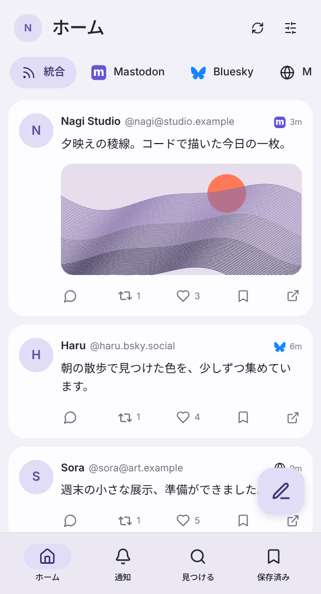
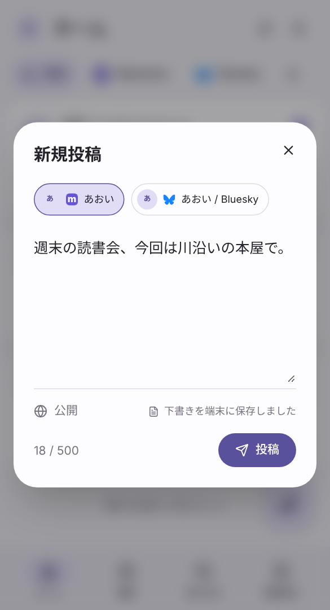

<p align="center"></p>
<h1 align="center">Noren</h1>
<p align="center">A self-hosted social client for Mastodon, Bluesky, Misskey, Nostr and X.</p>
<p align="center"><a href="README.md">English</a> · <a href="docs/ja/README.md">日本語</a> · <a href="docs/zh-CN/README.md">简体中文</a></p>

Read your accounts in one chronological timeline. When you post, choose the accounts that should receive it and edit the draft for each destination.

<p align="center">
  
  
</p>

[Operator guide](docs/en/guide.md) · [Example plugin](plugins/quote-local/) · [Cloudflare Workers](docs/en/guide.md#cloudflare-workers)

## Try it locally

From the repository root, use Node.js 24 and pnpm 10.34.5, or run `nix develop` to get both.

```sh
git clone https://github.com/yutakobayashidev/noren.git
cd noren
pnpm install --frozen-lockfile
FLARE_PREVIEW=1 pnpm dev
```

Open http://localhost:3000 to browse public posts. To connect your own accounts, configure OpenID Connect (OIDC) and sign in to Noren first.

## Connect an account

| Network | Available methods |
| --- | --- |
| Mastodon | OAuth or access token |
| Bluesky | OAuth or app password |
| Misskey | MiAuth |
| Nostr | NIP-07 browser signer |
| X | Signed-in Twitter Safe Relay profile |

Install the production build as a PWA over HTTPS or localhost. The client, landing page and plugin guide support English, Japanese and Simplified Chinese.

## Make the timeline yours

In **Settings → Browse plugins**, choose which actions appear on posts. Group posts that share a link, keep private notes on saved posts, or use PLaMo to translate a post on your own GPU. The model downloads on first use with your approval. Built with PLaMo.

The interactive author guide at `/site/en/plugins/` walks through turning a post into a Markdown quote with a JavaScript module and a manifest.

## Develop

- `pnpm check` — format, lint, type-check and run unit tests
- `pnpm build` — build the client and the embedded Astro site
- `pnpm site:dev` — start the standalone landing page

Pull requests run the `CI` check: `pnpm check`, the production build and Playwright
browser tests. The browser tests use development authentication and do not verify
production sign-in or real accounts. Device-specific changes still need the
requested physical-device checks.

The `main` branch requires a pull request and a successful, up-to-date `CI` check
before merging. Merge manually after reviewing the changes; an agent completing
its task or moving an issue to **In review** does not establish that CI passed.
Without a required check, GitHub can allow a merge even when no CI ran or a test
failed. Agents sharing the owner's GitHub credentials have the same permissions
as the owner; this setup does not enforce a separate human identity.

Local preview is available. Production sign-in, real-account checks and Android translation benchmarks are still open. [Release status](docs/en/release-status.md)

## License and credits

Noren is licensed under [AGPL-3.0-only](LICENSE). Its timeline and account navigation draw on [Flare for Android](https://github.com/flaresocialapp/Flare/tree/fd3979c2860ed509ecc97c6eef2212a977571282). See the [third-party notices](public/licenses/index.html) for bundled assets and libraries. Production builds serve the corresponding source at `/source.tar.gz`.
