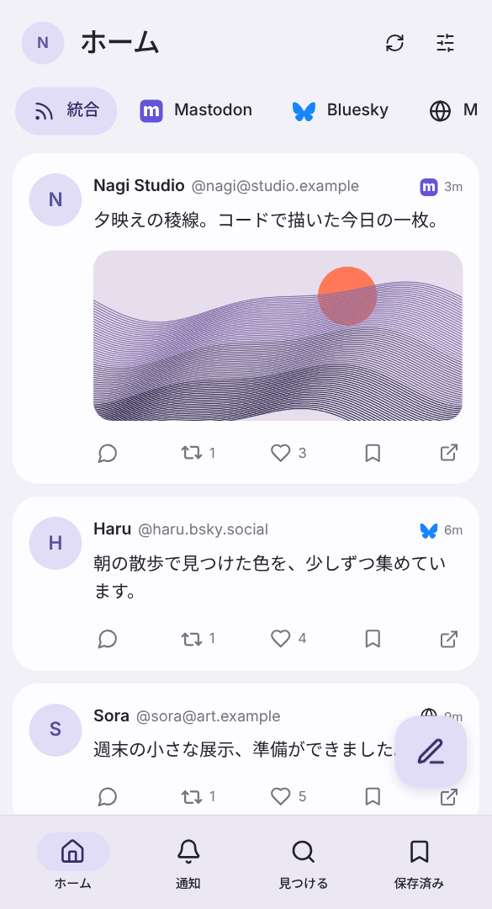
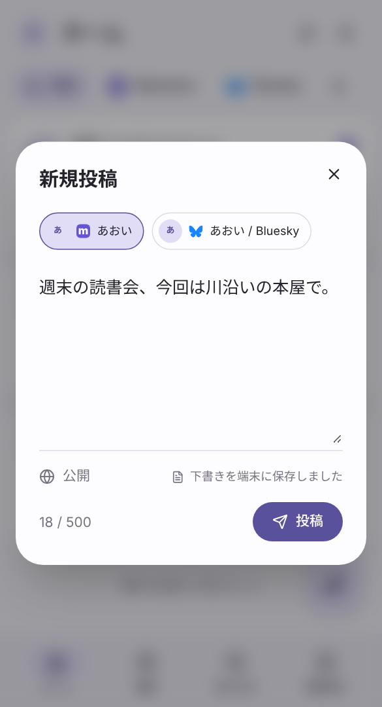

<p align="center"></p>
<h1 align="center">Noren</h1>
<p align="center">Mastodon、Bluesky、Misskey、Nostr、X をひとつのタイムラインで読める、セルフホスト型の SNS クライアント。</p>
<p align="center"><a href="../../README.md">English</a> · <a href="../../docs/ja/README.md">日本語</a> · <a href="../../docs/zh-CN/README.md">简体中文</a></p>

複数のアカウントの投稿を時系列で読めます。書くときは送信先を選び、下書きの本文をアカウントごとに調整できます。

<p align="center">
  
  
</p>

[運用ガイド](guide.md) · [プラグインの作例](../../plugins/quote-local/) · [Cloudflare Workers](guide.md#cloudflare-workers)

## 手元で試す

リポジトリのルートで Node.js 24 と pnpm 10.34.5 を使います。`nix develop` でも両方を用意できます。

```sh
git clone https://github.com/yutakobayashidev/noren.git
cd noren
pnpm install --frozen-lockfile
FLARE_PREVIEW=1 pnpm dev
```

http://localhost:3000 を開くと公開投稿を読めます。自分のアカウントを接続するには、OpenID Connect（OIDC）を設定して Noren にログインします。

## アカウントを接続する

| 接続先 | 接続方法 |
| --- | --- |
| Mastodon | OAuth またはアクセストークン |
| Bluesky | OAuth またはアプリパスワード |
| Misskey | MiAuth |
| Nostr | NIP-07 対応ブラウザ拡張による署名 |
| X | Twitter Safe Relay のログイン済みプロフィール |

HTTPS または localhost で本番ビルドを開くと、PWA としてインストールできます。クライアント、LP、プラグインの作者ガイドは日本語・英語・簡体字中国語で読めます。

## 読み方を変える

「設定 → プラグインを探す」で、同じリンクをまとめる、保存した投稿に私的メモを付ける、PLaMo で翻訳するなどの機能を選べます。翻訳は端末の GPU で実行します。初回はモデルの容量を確認してダウンロードします。Built with PLaMo.

`/site/plugins/` の作者ガイドでは、JavaScript と manifest を使って投稿を Markdown の引用に変換します。サンプルの本文を書き換えて動作を試せます。

## 開発

- `pnpm check` — 整形・lint・型・単体テストを確認する
- `pnpm build` — クライアントと同梱の Astro サイトをビルドする
- `pnpm site:dev` — LP のライブプレビューを起動する

現在はローカルで試用できます。本番の認証・各 SNS の実アカウントでの確認と Android 実機での翻訳計測が残っています。[リリース状況](../release-status.md)

## ライセンスとクレジット

Noren は [AGPL-3.0-only](../../LICENSE) で配布しています。タイムラインとアカウント操作は [Flare Android](https://github.com/flaresocialapp/Flare/tree/fd3979c2860ed509ecc97c6eef2212a977571282) を参考にしました。同梱素材・ライブラリの条件は[ライセンス一覧](../../public/licenses/index.html)に記載しています。本番ビルドは対応するソースを `/source.tar.gz` で配信します。
