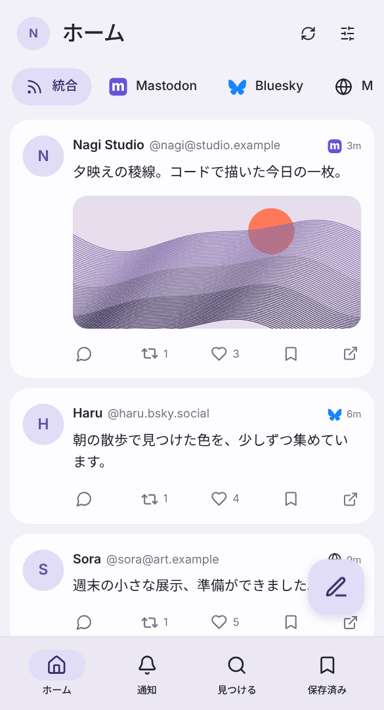
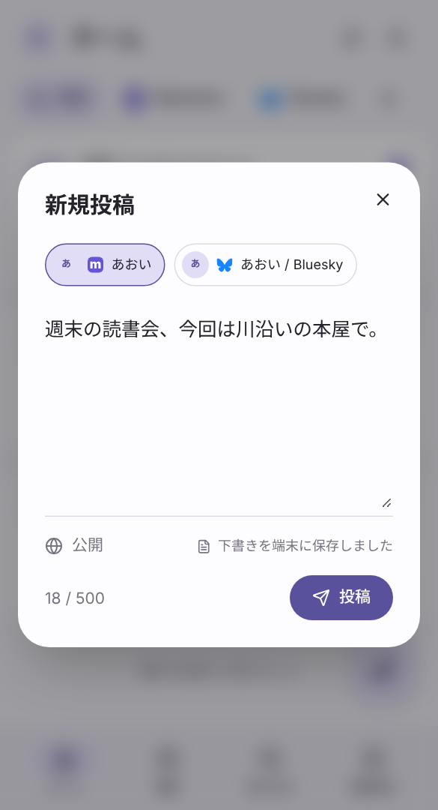

<p align="center"></p>
<h1 align="center">Noren</h1>
<p align="center">一个可以自行部署的社交客户端，支持 Mastodon、Bluesky、Misskey、Nostr 和 X。</p>
<p align="center"><a href="../../README.md">English</a> · <a href="../../docs/ja/README.md">日本語</a> · <a href="../../docs/zh-CN/README.md">简体中文</a></p>

在同一条时间线上按时间顺序阅读多个账号的帖子。发帖时可以选择目标账号，也可以为每个账号单独修改草稿。

<p align="center">
  
  
</p>

[部署指南](guide.md) · [插件示例](../../plugins/quote-local/) · [Cloudflare Workers](guide.md#cloudflare-workers)

## 在本地试用

在仓库根目录使用 Node.js 24 和 pnpm 10.34.5。也可以运行 `nix develop` 获取这两个工具。

```sh
git clone https://github.com/yutakobayashidev/noren.git
cd noren
pnpm install --frozen-lockfile
FLARE_PREVIEW=1 pnpm dev
```

打开 http://localhost:3000 即可浏览公开帖子。要连接自己的账号，请先配置 OpenID Connect（OIDC），然后登录 Noren。

## 连接账号

| 网络 | 连接方式 |
| --- | --- |
| Mastodon | OAuth 或访问令牌 |
| Bluesky | OAuth 或应用专用密码 |
| Misskey | MiAuth |
| Nostr | 通过支持 NIP-07 的浏览器扩展签名 |
| X | 已登录的 Twitter Safe Relay 配置文件 |

在 HTTPS 或 localhost 上打开生产构建即可安装 PWA。客户端、产品介绍页和插件开发指南均提供简体中文、日语和英语版本。

## 自定义时间线

在「设置 → 浏览插件」里选择需要的功能。你可以合并分享同一链接的帖子，为收藏的帖子添加私人笔记，或用 PLaMo 在设备的 GPU 上翻译帖子。首次使用翻译功能时，确认后才会下载模型。Built with PLaMo.

打开 `/site/zh/plugins/`，可以跟随交互式指南，用一个 JavaScript 模块和一份 manifest 将帖子转为 Markdown 引用。修改示例正文即可试运行。

## 开发

- `pnpm check` — 检查格式、代码质量和类型，并运行单元测试
- `pnpm build` — 构建客户端及内嵌的 Astro 站点
- `pnpm site:dev` — 启动独立的产品介绍页

目前可在本地试用。生产环境登录、各网络真实账号的验证以及 Android 真机翻译性能测试仍待完成。[发布状态](release-status.md)

## 许可证与致谢

Noren 使用 [AGPL-3.0-only](../../LICENSE) 许可证。时间线与账号导航参考了 [Flare Android](https://github.com/flaresocialapp/Flare/tree/fd3979c2860ed509ecc97c6eef2212a977571282)。随附资源和库的条款见[第三方许可声明](../../public/licenses/index.html)。生产构建会在 `/source.tar.gz` 提供对应的源代码。
